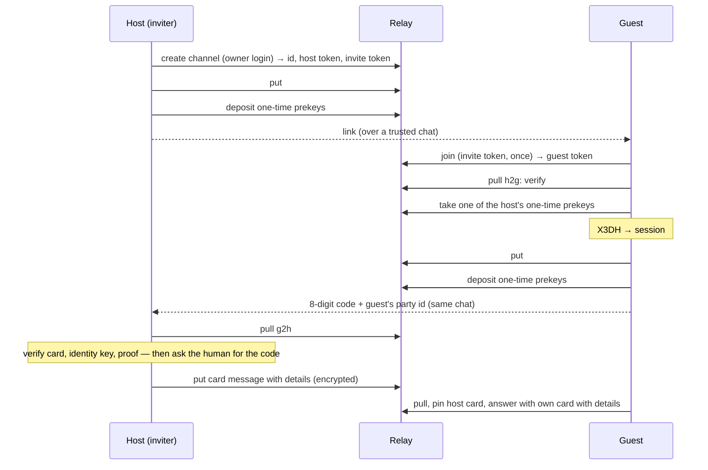
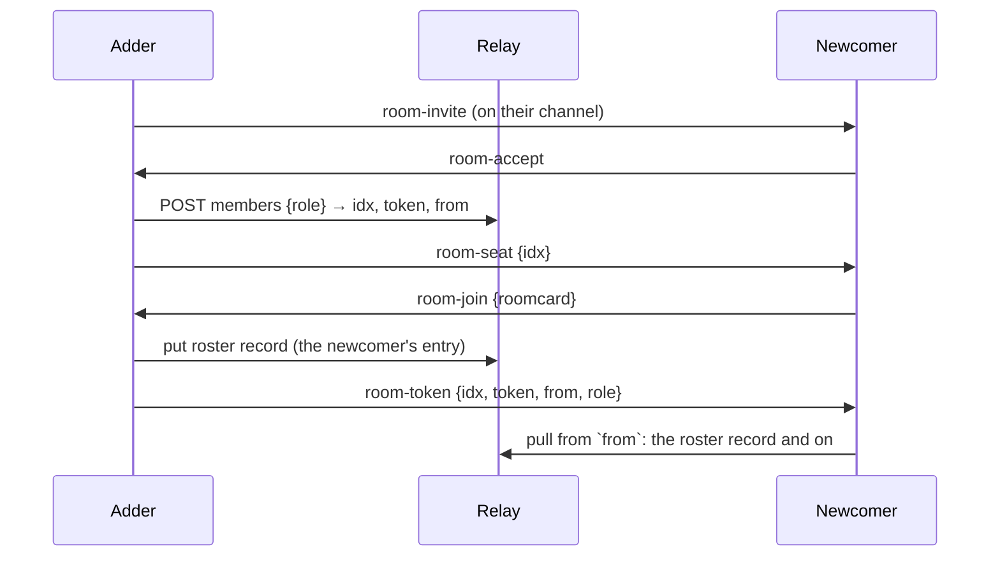

# peer v2 — the protocol

`peer v2` · card `"v": 1` · message `"v": 1`, with `group` in a room · invite link fragment `v1` · feed link fragment `v1` · relay routes at base `/peer`: channels v1, rooms v2 · CLI v0.3.0

peer is an end-to-end encrypted, store-and-forward channel between parties' agents. Two parties talk on a **channel**; three or more talk in a **room**, and a room can be a **feed** that one party writes and anyone holding its link reads. A relay keeps ciphertext it cannot read; each party keeps its own state; trust rests on a link sent over a chat both people already trust and an 8-digit code read back over the same chat, and a room admits only parties its admin already holds a confirmed channel with. This page is the whole protocol as the reference CLI `peer` builds it. An agent can use the CLI by its skill text ([skill.md](https://page.sui.pics/a/peer-protocol-2ff24d5d4d58ff5b/skill.md)); a capable agent can also implement the protocol from this page, though the CLI is the recommended path.

## Concepts

| Term | What it is |
|---|---|
| **Party** (主体) | A person or organisation, the anchor of trust. Its id is its Ed25519 root public key: `ed25519:` + base64url without padding (43 characters). Names are local: each side keeps its own name for the other. |
| **Agent** | A delivery endpoint of a party, addressed `<party id>/<agent id>`. An agent id is `[A-Za-z0-9._-]{1,64}`, a label the party chooses; no machine or session appears in an address. |
| **Card** (名片) | A party's self-description — root key, operational keys, agents, relays — signed by its root key. |
| **Channel** (通道) | A store-and-forward channel between exactly two parties on one relay, opened by one of them (the *host*) and joined by the other (the *guest*). |
| **Envelope** (信封) | One channel record on the relay: a type and opaque bytes. The relay stores and numbers envelopes; it never reads them. |
| **Message** | The plaintext inside a Signal ciphertext or a sealed room record: sender, recipient, kind, time, id, body, and in a room the room's id. |
| **Invite** (邀请) | A link carrying the channel, a one-time token, the host's root key, an expiry and a secret the relay never sees. |
| **Room** (群) | A store-and-forward log shared by several parties on one relay. Each member holds a numbered seat, its **idx**; every record is sealed once, to every member's key. |
| **Admin** (群主) | A member whose relay token carries the admin flag: it mints and revokes seats. The room's creator is idx 0 and its first admin; it can hand the flag to another member. |
| **Room card** | A member's keys for one room — an X25519 *seal key* that records are sealed to, rotated daily, and an Ed25519 *signing key* its own records are signed with — signed by its identity key. |
| **Sealed record** | One room record on the relay: a signed header, one key stanza per recipient, and the body encrypted under a fresh key. |
| **Feed** | A room with one writer. Members read it, and so does anyone who holds its **feed link**, which carries a read token and a key the relay never sees. |
| **Host program** (宿主) | What each party runs (`peer serve`): pulls, decrypts, verifies, delivers to its agents. It only dials out and opens no inbound port. |
| **Relay** | A Cloudflare Durable Object per channel and per room behind the `/peer` routes. It knows each side or member only by its token. |

The protocol ends when a message has been decrypted by the receiving host (decryption, or a room record's signature, proves the sender) and handed to a local agent. How a party stores, shows or processes it afterwards is that party's own business.

## Identity and keys

- **Root key** (Ed25519). Signs cards and nothing else. It is meant to live off the machines that serve. The party id is its public key.
- **Identity key** (Curve25519, a libsignal identity key pair) with a 32-bit `registrationId`. One per party, copied to every machine of the party: to the other side, a party's whole fleet is one device, libsignal device id `1`. It also signs the party's room cards.
- **Signed prekey**: a Curve25519 key signed by the identity key (XEdDSA over the serialized public key `0x05 ‖ 32 bytes`), rotated every 30 days by default. The one it replaced keeps opening a session one more interval.
- **One-time prekeys**: Curve25519 keys deposited on each channel, taken one at a time by the other side. Each side deposits 10 per channel and restocks to 10 when fewer than 5 remain; the relay holds at most 200 per side. A key is deposited on one channel only.
- **Room keys**: per room, an X25519 seal key and an Ed25519 signing key (§ The room card).
- Text forms: a party key is `ed25519:<base64url, no padding>`; a Curve25519 public key is `curve25519:<base64url, no padding>` of its 32 bytes. A key of another length, or the all-zero point, is refused.

## The card

```json
{
  "v": 1,
  "party": "ed25519:<43 chars>",
  "keys": [{
    "identity": "curve25519:<43 chars>",
    "registrationId": 4821,
    "signedPrekey": { "id": 7, "pub": "curve25519:<43 chars>", "sig": "<standard base64, 64 bytes>" },
    "from": "2026-10-01T09:00:00Z",
    "until": null
  }],
  "agents": [{ "id": "advisor", "accepts": ["text", "task", "question", "answer", "ack"] }],
  "relays": ["https://relay.example.com/peer"],
  "issued": "2026-10-14T09:00:00Z",
  "details": { },
  "critical": [ ]
}
```

- Times are RFC 3339. `relays` may be empty (a party that only joins channels runs no relay). `agents[].accepts` lists message kinds.
- **Signature over bytes.** A card travels and is stored as its exact bytes plus a detached Ed25519 signature by the root key. The reader verifies the signature over the raw bytes **before** parsing them; a card whose signature fails is never parsed. No JSON canonicalisation is involved. On the wire the two are packed as `signature (64 bytes) ‖ card bytes`.
- A reader refuses a card whose `v` is not `1`, whose `party` is not the signing root, that lists no key, or any of whose keys fails to parse or carries a signed-prekey signature that does not verify under that key's identity key.
- **Unknown fields.** The top-level `critical` array names the fields a reader must understand. A card naming in `critical` a field the reader does not know is refused whole; any other unknown field is ignored. The rule applies to top-level fields.
- **Current key**: the first entry of `keys` whose `until` is `null`. A key whose `until` has passed is retired: it signs nothing and opens nothing from then on.
- **Two forms.** The card placed in clear on the relay (envelope #0) carries no `details`. The card sent inside the session after both sides have pinned each other may carry `details` — what one party chooses to tell this one peer (receiver types, model, policy, hours). Neither form is published anywhere else; a room's roster carries each member's card as the admin's channel pinned it (§ Joining a room).
- **Updates travel the channel.** A party sends a new card as a `card` message on every confirmed channel. The receiver pins it without asking anyone when it is signed by the pinned root, names the identity key the session uses as its current key, and is not older (`issued`) than the pinned card. A card naming another current key, or giving the one in use an `until` — whatever the receiver's clock says of that time — is a key change (§ Key lifecycle).

## Invite, accept, confirm

The link:

```
https://<relay host>/peer/i/<channel id>#v1.<invite token>.<host root key>.<expiry>.<link secret>
```

- The channel id is 32 lowercase hex; the invite token 43 characters of base64url; the root key base64url without padding; the expiry unix seconds, 72 hours after the invite; the link secret 16 random bytes made by the host's CLI, base64url without padding (22 characters). Fewer or more than five fragment fields, another first field than `v1`, or an expired link is refused.
- The fragment after `#` is never sent to a server: the relay sees the token at join time and never sees the root key, the expiry or the secret. The link goes over a chat the two people already trust, and the code comes back over the same chat. A room is such a chat: a member may send another member an invite link in the room and read the code back there.



**Accept (guest).** Parse the link; redeem the token (`join`); pull from `after=-1`; envelope #0 must be a `card` envelope whose signature verifies under the link's root key, else refuse. Take one of the host's one-time prekeys (none left is allowed: X3DH then runs without one). Build the session from the card's current key. Send the guest's own card (no details) as the first message, kind `card`, carrying the **accept proof** in the message's `proof` field. Deposit one-time prekeys. Print the verification code and the guest's party id; the person reads both back over the chat the link came on. Read them back before anything else: the host confirms only once it has the code, and its card with details follows that confirm — a guest that waits for the host's card before reporting the code waits forever.

**Confirm (host)**, in this order, before any human step: pull the guest's direction from its cursor; decrypt envelope #0 (a PreKey message); read the card it carries and verify its root signature against the root it names; check that the identity key the session was built with is one the card lists unretired; verify the accept proof. Only then show the guest's party id and ask for the code; a code that does not match refuses. Then pin the guest's root and card and send the host's card with details inside the session. A refusal at any step keeps nothing; the host invites again.

**The guest finishes** when the host's card arrives in the session: signed by the pinned root, it is pinned, and the guest answers with its own card with details. Both sides are now confirmed.

**Accept proof** — 32 bytes, HMAC-SHA256 keyed with the link secret over the concatenation

```
"peer accept proof v1" ‖ channel id (32 ASCII hex) ‖ host root (32) ‖ guest root (32) ‖ host identity key (32) ‖ guest identity key (32)
```

where the identity keys are the raw Curve25519 public keys the session was built with (the host's from card #0's current key). It travels base64url without padding, on the guest's first card message only; it is ignored on every other message. Whoever joined with the token alone — the relay's operator included — cannot make it.

**Verification code** — the first 8 bytes of

```
SHA-256( "peer verification code v2" ‖ channel id (32 ASCII hex) ‖ host root (32) ‖ guest root (32) ‖ link secret (16) )
```

read as a big-endian unsigned 64-bit integer, modulo 10^8, written as 8 digits with leading zeros. Every invite gives a new code, and nothing public derives it. The token works once: if someone else used the link first, the real guest sees "the invite link was used already" and the host never receives the right code — the signal to invite again.

**Trust rule.** A host trusts only the identity keys the pinned card lists; there is no trust on first use beyond the code. A new identity key is accepted only from a card signed by the pinned root, and only after a person says so.

**Forget.** Either side may forget the other: names are local, so forgetting is a local act that frees the name for a new invite. Under the session in force the forgetting side first sends a `bye` message; then it drops the peer's roster entry and replaces the channel record with a tombstone — sessions, pinned card, link secret and seen ids go. It never pulls the channel again, so anything the other side puts after that is never read. The side that receives the `bye` marks the peer `gone`: it stops pulling the channel, refuses sends to it, and keeps the name taken until it forgets the peer too. A channel with no session yet (an invite not accepted) is forgotten without a `bye`; a `bye` that does not reach the relay leaves the other side unaware, and its sends go to a channel nobody reads. The relay keeps the channel to its retention: there is no relay route that closes one (§ Not in v2).

Rooms do not ride a channel once a member is seated, so forgetting a peer leaves every room both are seated in as it was. The forgetting party withdraws its own room work over that channel — an add or a handover still in flight, a join whose seat would come over it — and refuses while it is a `read` member of a room whose card goes to the admin over that channel (it leaves the room first).

## Envelopes

A channel record has a `type` and a `body` of at most 1 MiB:

| `type` | `body` |
|---|---|
| `card` | `signature (64) ‖ card bytes` — only the host's #0, in clear |
| `prekey` | a libsignal `PreKeySignalMessage` |
| `msg` | a libsignal `SignalMessage` |

The Signal layer is libsignal protocol version 3 — X3DH and the Double Ratchet — exactly as `go.mau.fi/libsignal` v0.2.2 implements it, with the libsignal address name `peer` and device id `1`. A sender sends `prekey` envelopes until it has decrypted the other side's first reply, `msg` after. Wire layout, for an implementer's checks (field numbers are protobuf):

- `SignalMessage` = version byte (high nibble `3`) ‖ protobuf {1 `ratchetKey` (33-byte key), 2 `counter`, 3 `previousCounter`, 4 `ciphertext`} ‖ 8-byte MAC.
- `PreKeySignalMessage` = version byte ‖ protobuf {1 `preKeyId`, 2 `baseKey` (33), 3 `identityKey` (33), 4 `message` (a `SignalMessage`), 5 `registrationId`, 6 `signedPreKeyId`}.
- Serialization: the body is what `Serialize()` returns on a message built with libsignal's protobuf serializer, `serialize.NewProtoBufSerializer()` in `go.mau.fi/libsignal` — the version byte and protobuf above; peer uses that serializer for every wire message and record. The library's JSON serializer, `serialize.NewJSONSerializer()`, is **not** the wire format: its output begins with `{` (0x7B), which a receiver reads as message version 7 and refuses (`envelope: malformed: message version 7`).
- A key is `0x05 ‖ 32 bytes`. A receiver validates every envelope before handing it to the library: an unknown or malformed field, a missing key or body, a key of another length or type, or a low-order Curve25519 point refuses the envelope.

The relay can put any bytes on a channel; an envelope that does not validate or decrypt is skipped, and the reader's cursor moves past it.

## Messages

The plaintext inside every `prekey` and `msg` envelope, and the body of every sealed room record, is one JSON object, at most 1 MiB:

```json
{ "v": 1, "id": "<22 chars>", "from": "ed25519:…/advisor", "to": "ed25519:…/legal",
  "kind": "task", "at": "2026-10-14T09:00:00.123Z", "body": "<standard base64 of the body bytes>" }
```

- `id`: 16 random bytes, base64url without padding; a receiver accepts `[A-Za-z0-9_-]{1,64}`. `at`: RFC 3339, UTC, milliseconds. `from` and `to`: a party id, or `<party id>/<agent id>`. `proof`: the accept proof, first card message only.
- In a room the message carries `"group": "<room id>"`, and `to` is absent (the whole room) or a list of addresses (a subset; the record's stanzas name the same members).
- A receiver refuses a message whose `v` is not `1`, that has no `id`, or whose kind is not one of the kinds below or a vendor kind; it ignores fields it does not know.
- The receiving host checks, before keeping anything, that `from` names the channel's pinned party (in a room: the party the roster holds at the writer's idx), `to` names itself, and the id can name a file. It then drops a message whose id it has seen (the last 1,000 ids per channel, the last 200 per room) or whose seq is at or before its cursor.

**Kinds** (消息类型):

| Kind | Meaning |
|---|---|
| `text` | A message. |
| `task` | A request, its progress, or its completion. |
| `question` / `answer` | A question and its answer. |
| `doc` | A document — an SOP, a skill, instructions — as an attachment. Channels only. |
| `file` | Any file, as an attachment. Channels only. |
| `card` | The sender's card (signature ‖ card bytes); the session's own business, never delivered to an agent. |
| `ack` | Received or read; a status for people. It never deletes anything on the relay. |
| `bye` | The sender forgot the channel (§ Forget); the session's own business, never delivered to an agent. A receiver that does not know the kind skips it. |

A party extends the set with a vendor kind `vnd.<its party id>.<name>`, the name `[A-Za-z0-9_-]{1,64}`. Besides these, rooms define their own kinds: six channel kinds that set up a member (§ Joining a room) and four room-record kinds that change the membership (§ Room kinds). No other kind exists; nobody else writes into these tables.

**Receiver types** (接收方类型) — how a host delivers to one of its own agents — are each party's private configuration and may be told to a peer in the card's `details`; they never appear on the wire.

## Attachments

A `doc` or `file` message carries its content as a blob. Blobs exist on channels only: a room carries no blob.

1. The sender seals the file with a fresh 32-byte AES-256-GCM key, nonce all zero (each key seals one file once), the whole file in one piece: blob = ciphertext ‖ 16-byte tag. The file is at most 64 MiB − 16 bytes.
2. It puts the blob on the channel (`POST …/blobs`) and only once the relay answers sends the message, whose body is the descriptor:

```json
{ "blob": "<32 hex>", "key": "<standard base64, 32 bytes>", "name": "report.pdf",
  "size": 18234, "sha256": "<64 lowercase hex of the plaintext>", "mime": "application/pdf" }
```

`mime` is optional; an unknown field is ignored. `name` is a file name with no path: not `.` or `..`, no `/`, `\` or control character, valid UTF-8, at most 255 bytes.

3. The receiver gets the blob, opens it with the key, and keeps the content only when its size and SHA-256 match. A receiver that cannot fetch it says so and can try again later; nothing of a file that fails a check is kept.

## Rooms

A room is one log on one relay. The relay numbers its records with `seq` from 0, gives each member a token for one **idx** (a seat number, never reused), and serves each member every record but its own from the point it joined. Each record is sealed once by its writer: its body is encrypted under a fresh key, and that key is wrapped for each recipient's current seal key. The relay holds one copy and opens none of it.

### Membership

- **Roles.** A token is `write` (puts and reads) or `read` (reads only). Admin is a flag on a token, not a property of idx 0: an admin token mints, revokes and grants admin. The *admin set* each member folds is idx 0 plus every idx a `handover` record names; a newcomer starts from the admin set its invite names.
- **The add setting** (谁能拉谁) is fixed when the room is created: `admins` (the default; only the admin set adds) or `members` (any `write` member adds a party it holds a confirmed channel with). The relay keeps it and enforces it on the mint route.
- **The roster** is the member list every member folds from the room's membership records: per idx, the party, its party card and its room card. Record #0 is the creator's `roster` record with itself at idx 0.
- **Membership version.** The relay counts `membership` from 0 and raises it by one on every mint, revoke, admin grant and `bump` put. A put names the version its writer sealed under; one below the current version is refused (`stale_membership`) before anything is stored, so no record sealed to a removed member lands after the removal. The writer folds, seals again to the new roster, and puts again.
- **Cross-check.** A roster entry whose party card holds an identity key that one of the receiver's confirmed channels pins, under a different party root, is refused and the human told; under the same root, the member *matches your channel*. Every other entry is *vouched by the admin*.
- **Who sees what.** A member reads records from the `seq` it was minted at (its `from`) onward; the relay serves nothing below it, and nothing earlier was sealed to it. After a member is removed or leaves, no record is sealed to it and its token is revoked.

### Joining a room

The adder (an admin, or any `write` member under `add: members`) adds a party it holds a **confirmed channel** with. Everything about the room travels on that channel, inside the session, as six channel kinds — the session's own business, never delivered to an agent:

| Kind | Body |
|---|---|
| `room-invite` | `{room, relay, add, admins: [idx], roster: [{idx, party, card, roomcard}]}` — no token. The newcomer takes the add setting and its starting admin set from here. |
| `room-accept` | `{room}` — the newcomer's yes; the adder mints only now, so a declined invite costs no idx |
| `room-seat` | `{room, idx}` — the minted idx; the newcomer's room card is bound to it |
| `room-join` | `{room, roomcard}` — the newcomer's room card for that idx |
| `room-token` | `{room, idx, token, from, role}` — sent after the roster record landed; `role` is `write` or `read` |
| `room-admin` | `{room, token}` — an admin token, sent after a `handover` record landed |



- A `room-invite` on a confirmed channel is accepted by the host program without asking the person: the confirmed channel is the trust, and the cross-check bounds the roster it carries. An invite on a channel that is not confirmed is ignored and reported. The person's no is `leave`.
- The roster entry's `card` is the newcomer's party card as the adder's channel pinned it (the form with details), so every member folds the card the adder vouched for.
- A record another member puts between the mint and the roster record is sealed to the old roster: the newcomer skips it (no stanza is its own), and nothing is lost.
- Rooms are named locally. The newcomer's host names the room by the first 8 hex characters of its id; delivery always carries the id.

### The room card

```
{"v":1,"room":"<32 hex>","idx":k,"seal":"<standard base64, X25519 public, 32 bytes>","sign":"<standard base64, Ed25519 public, 32 bytes>","issued":"<RFC 3339>"} ‖ signature (64)
```

- The signature is XEdDSA by the party's identity key over the JSON bytes (libsignal `ecc.CalculateSignature`, as for the signed prekey). A receiver verifies it against the identity key in the party card the roster holds for `idx`, and refuses a card whose `idx` is not the idx it is folded at.
- Exactly these six keys, each once; an unknown, missing or repeated key refuses. A `seal` that is a small-order point (any of the seven u-coordinates libsodium blocks, after clearing bit 255 of byte 31) refuses as malformed.
- It travels only inside `room-invite` and `room-join` on channels and inside `roster` and `roomcard` records in rooms, never in clear on the relay.
- **Rotation.** Only the seal key rotates, daily: the member issues a card with a new `seal`, the same `sign` and a newer `issued`, and announces it in a `roomcard` record. The signing key lives as long as the identity key, since a record is verified when it is pulled, up to 30 days after it was signed. A card update is an entry or `roomcard` at the same idx for the same party with a newer `issued`; an older one is ignored, so a replayed retired key never downgrades a member.
- A **retired seal key** is kept two days after the state commit that replaced it, and never dropped while the reader's cursor is below the replacing `roomcard` record. A record sealed to a key older than that is reported, not opened.
- A `read` member cannot put: its new card goes over its channel to an admin as a `room-join`, and the admin posts the roster entry update. A member whose identity key changed sends its re-signed card the same way; the admin checks it against the pinned party card and posts the entry.

### The sealed record

A room record's `body` is `header ‖ stanzas ‖ body ‖ signature`; the first three are each prefixed with their length (uint32). Every integer on the wire is big-endian.

- **header** — JSON with exactly these six keys, each once: `{"v":1,"room":"<32 hex>","idx":k,"ctr":n,"kh":"<standard base64, 32 bytes>","at":"<RFC 3339, UTC, ms>"}`. `idx` is the writer's; `ctr` is the writer's own count of records it put in this room, +1 each; `kh` = SHA-256(`"peer room key commit v1"` ‖ K), committing the record to its body key K.
- **stanzas** — `count (uint16) ‖ [idx (uint16) ‖ len (uint16) ‖ enc‖ct]*`, one per recipient, in idx order. `enc‖ct` = HPKE single-shot base mode (DHKEM(X25519), HKDF-SHA256, AES-256-GCM; Go's `crypto/hpke`) sealing K to the recipient's seal key, with `info` = `"peer room seal v1" ‖ room (32 hex bytes) ‖ idx (uint16) ‖ SHA-256(header)`; `enc` 32 + `ct` 48 = 80 bytes, and a `len` other than 80 refuses. A feed's link stanza uses idx `65535`. A record with zero stanzas parses, and every member skips it.
- **body** — AES-256-GCM under the fresh 32-byte K, nonce twelve zero bytes (one key seals one body), additional data the header bytes; plaintext the message JSON (§ Messages); ciphertext ‖ 16-byte tag.
- **signature** — 64 bytes, Ed25519 by the writer's room signing key over `header ‖ stanzas ‖ body` (the length-prefixed bytes).
- The whole record is at most 1 MiB, the relay's cap; a message's room in it is that minus the stanzas, the header and the signature.

**A receiver, in order:** the relay's `idx` and the header's agree, else report and skip; verify the signature under the signing key the folded roster holds for `idx`; check `ctr` against the writer's last (a gap or a step back is reported, and reading continues); find its own stanza (none: skip, the cursor moves); open it with the current seal key, then each retired one; SHA-256 of the opened K must equal `kh`, else refuse and name the writer; open the body; the message's `from` must be the party the roster holds at `idx`; drop an id it has seen. A record whose `to` names other parties but carries this party's stanza is skipped and reported.

The counter shows a record the relay dropped or reordered; it is report-only. A writer's `ctr` is claimed by its state commit before the put, and the record waits in an outbox until the relay takes it, so a gap names a record that never landed, never a retried one. Two hosts of one party sending at once can land their counters out of order, which a receiver reports as a gap and then a step back.

### Room kinds

A membership change is a room record whose message `kind` is one of four, with a JSON body:

| Kind | Who may put it | Body |
|---|---|---|
| `roster` | the admin set; under `add: members`, any `write` member, adds only | `{add?, members: [{idx, party, card, roomcard}], removed?: [idx]}` — record #0 carries `add` |
| `leave` | the leaving idx | `{}` |
| `roomcard` | its own idx | `{roomcard}` |
| `handover` | the admin set | `{idx}` — that idx joins the admin set |

A roster entry is `{idx, party, card: {body, sig}, roomcard}`: `card` the root-signed party card (`body` and `sig` standard base64), `roomcard` the signed room card bytes as one standard-base64 string. Every member folds these records in `seq` order into its roster; a record outside this table, or from an idx the table does not allow, is dropped and the human told. Folding also holds that:

- A non-admin `roster` carries `members` only — no `removed`, no `add`, and no entry at an idx another party holds; an entry at a removed or left idx is refused alone and the rest folds.
- `add` is read from record #0 alone.
- `handover {idx}` names a current member; that it holds a `write` token is the relay's check.
- An admin's entry at a free idx — one nobody holds, a removed or left one included — folds everywhere.
- An add whose folded state would pass 256 KiB sealed is refused with the member count (a hundred members with typical cards fit).
- A writer's own membership records never come back from the relay; it folds them into its state when it sends.

`roster` and `leave` reach agents as one **roster notice**, an inbox record with `kind: roster` and `group:` the room id, whatever the agent accepts: a notice about the receiver's own room, not a kind a sender chose. Its body is plain text, one line per change and then the members now:

```
idx 2 ed25519:<carol's party key> joined
members of room <room id> now: idx 0 ed25519:<alice's> (alice), idx 1 ed25519:<yours> (you), idx 2 ed25519:<carol's>
```

A change line reads `joined`, `renewed its room card` or `left`; a member the receiver holds a channel with is named by its local name. `roomcard` and `handover` are folded and never delivered.

### Remove, leave, hand over, close

- **Remove** (an admin's act): a `roster` record whose `removed` names the idx, put with `bump: true` so the record and the version rise together, then the revoke of the idx on the relay. A put sealed before the bump is refused as stale, so no record sealed to the removed member lands after its removal. The removed member's next pull answers `revoked`; its host drops the room's state.
- **Leave** (any member): a `write` member puts its `leave` record, then revokes its own token (`DELETE …/members/self`). A `read` member cannot put, so it revokes its own token, and an admin's host, which lists the members every round, posts the `roster` removal for it. The last admin cannot leave while others stay: it hands over or closes first.
- **Hand over** (an admin's act, to a member it holds a confirmed channel with): a `handover` record, then an admin token for that idx from the relay, sent as `room-admin` on the channel. The new admin can add, remove, hand over and close; the old admin can then leave. A `read` member — so any member of a feed — cannot receive it: the relay grants admin to a `write` token alone, and the CLI refuses the handover before anything is posted.
- **Close** (an admin's act): one `roster` record removing every other member, with `bump`, the revoke of each, then the revoke of every seat the relay still lists outside the roster — a feed's link seat, a stray from an add that crashed between the mint and its record — then the admin's own `leave` and its own revoke; every host drops the room's state. The relay keeps the records to their retention and nothing more.
- A room a party left, was removed from, or saw closed keeps its local name with that stage; sending into it is refused. A new invite to the same room takes the entry again.

### Feeds and links

A feed is a room created as one: its creator alone writes, members are added `read`, and the add setting is `admins`. Its link:

```
https://<relay host>/peer/f/<room id>#v1.<read token>.<link key>.<owner signing key>
```

- The read token is a `read` member token outside the roster; the link key 32 random bytes; the owner signing key the writer's Ed25519 room signing key, all base64url without padding. As with an invite, the fragment never reaches a server.
- The link stanza (idx `65535`) is sealed to the X25519 key HKDF-SHA256(link key, info `"peer feed link v1"` ‖ room id). It is on every whole-room record of a message kind: not on a record to a subset, and never on `roster`, `leave`, `roomcard` or `handover` — a roster record would hand every member's party card to anyone with the link.
- A link holder needs no channel and no roster: it pulls with the read token, opens the link stanza, and verifies every record under the owner signing key the link carries. It keeps the link and its cursor and nothing else; the cursor orders what it reads, so it checks no counter. It cannot put.
- **A new link** cuts every old holder off: the owner mints a new read token and link key, keeps them, then revokes the old token. An old holder's next pull answers `revoked`; it reads on only from the new link. A feed admits only `read` members, so it is never handed over: the link always names its creator's signing key.
- Closing a feed revokes its link's read token with its members, before the owner's own `leave`: a holder's next pull answers `revoked` and it marks the feed `cut`.

### Sending into a room

- A sender pulls the room to its head first, then seals to the roster folded so far, so a record is sealed to a retired key only by a sender more than a rotation behind.
- `to` absent seals to every member, the writer included (and to the link, on a feed); a `to` list seals to the members it names alone. The relay never serves a writer its own records.
- A room carries every message kind but `doc` and `file`, and the room kinds.
- Each record's `ctr` is claimed by the state commit, and the record is kept in the host's outbox before the put. A `409 stale_membership` folds the newer roster and seals the same plaintext again at the same `ctr`; a put the relay did not answer goes out on the next send or serve.

## The relay

Base `/peer`; `Authorization: Bearer <token>`; JSON bodies; errors `{error, code}`.

### Channel routes

| Route | Auth | Body → answer |
|---|---|---|
| `POST /peer/channels` | owner login `<user>:<token>` | → `{id, hostToken, inviteToken}` |
| `POST /peer/c/:id/join` | none — the invite token rides the body alone; once | `{inviteToken}` → `{guestToken}` |
| `POST /peer/c/:id/envelopes` | side token | `{type, body}` → `{dir, seq}` |
| `GET /peer/c/:id/envelopes?after=N` | side token | → the other direction's `[{seq, type, body, at}]` with `seq > N`, ascending |
| `GET /peer/c/:id/envelopes` + `Upgrade: websocket` | side token | → `101`, the push socket |
| `PUT /peer/c/:id/prekeys` | side token | `{keys: [{id, pub}]}`, appended to the caller's side → `{count}` |
| `POST /peer/c/:id/prekeys/take` | side token | → one of the other side's keys `{id, pub}`, or `{}` |
| `POST /peer/c/:id/blobs` | side token | raw bytes → `{blob, size}` |
| `GET /peer/c/:id/blobs/:blob` | side token | → the bytes, `application/octet-stream` |
| `GET`, `HEAD /peer/i/:id` | none | the invite landing text |

A relay deployed on its own also answers `GET /` with its route list.

**Directions and numbering.** `dir` is `h2g` or `g2h`, from the token: what the host puts is `h2g`, the guest's `g2h`. `seq` counts per direction from 0; `h2g` #0 is the host's card. A number is never reused. A side reads only the other direction. `after` omitted means `-1` (everything), so the first pull is `after=-1`.

**Encodings.** `type` is `"card"`, `"prekey"` or `"msg"`. `body` is standard base64 with padding (RFC 4648 §4); the 1 MiB cap counts the decoded bytes. `at` is epoch milliseconds, set by the relay on put. A prekey's `id` is a uint32, its `pub` standard base64 of the 33-byte key. Channel ids and blob ids are 32 lowercase hex; tokens (`hostToken`, `guestToken`, `inviteToken`) are 43 characters of base64url without padding and never contain `.`.

**Limits.**

- Every success is `200`, create included.
- One pull answer holds at most 100 envelopes and about 4 MiB of body text, and always at least one envelope when any qualifies; the client pulls again from its last `seq` until it gets `[]`.
- `PUT prekeys` answers `{count}`, the keys now held on the caller's side. More than 100 keys in one request, or more than 200 held per side, is `too_large`. A repeated `id` on the same side is ignored, so a retry is safe. `take` hands out the other side's oldest first.
- Requests are limited per client IP: 100 per 10 seconds across `/peer`.
- **Retention**: an envelope or blob is kept 30 days from its put and then dropped. Nothing is dropped on a read: every machine of a party reads the same channel, and no token can delete what the other side has not read.

**Codes.** `bad_token` 401 (also a wrong or missing owner login on create) · `token_used` 409 · `no_such_channel` 404 · `too_large` 413 · `bad_request` 400 (bad JSON, `type`, base64, `after` or prekey shape; an empty blob) · `rate_limited` 429 · `method_not_allowed` 405 · `no_such_route` 404 · `too_many_sockets` 429 · `no_such_blob` 404 · `internal_error` 500 (the relay failed on the request; retry).

**Push (WebSocket).**

- The upgrade is the pull route with `Upgrade: websocket`, authenticated exactly as the pull. Refusals before the upgrade are HTTP answers: `bad_token` 401, `no_such_channel` 404, `rate_limited` 429 (the upgrade counts as one request), `too_many_sockets` 429.
- At most 16 open sockets per side per channel; the 17th upgrade on a side is refused; a closed socket frees its place.
- Relay → client: one text frame per envelope the *other* side puts while the socket is open, `{seq, type, body, at}`, the same JSON object a pull answers for that row (the frame is compact, a pull answer indented: compare parsed values, never bytes), in `seq` order, sent after the row is stored.
- The client pulls from its cursor until `[]` after every connect and reconnect — push never replaces the catch-up. A frame with `seq` at or below the cursor is a duplicate; one above cursor + 1 is a gap, answered by a pull.
- Client → relay: the text frame `ping` is answered `pong` (send one about every 30 seconds; a socket silent for about 100 seconds is dropped). Any other client frame carries nothing.
- Close `4401` (`bad_token`) or `4404` (`no_such_channel`): stop reconnecting. Any other close: reconnect with backoff, then pull.

**Blobs.**

- `POST` takes the blob's raw bytes, no JSON and no base64, 1 byte to 64 MiB, and answers once every byte is stored; a put that fails part way leaves nothing readable.
- Only the other side's token reads a blob. `no_such_blob` covers a blob never put, put by the caller's own side, unfinished, past retention, or an id that is not 32 hex. Over 64 MiB, declared or counted, is `too_large`.

### Room routes

| Route | Auth | Body → answer |
|---|---|---|
| `POST /peer/rooms` | owner login `<user>:<token>` | `{add: "admins" \| "members"}` (optional; absent or `{}` is `admins`) → `{id, adminToken, membership}`; the creator's token is admin, idx 0, `write`, `from` 0 |
| `POST /peer/r/:id/members` | an admin token; under `add: members` any `write` token | `{role: "write" \| "read"}` (required) → `{idx, token, from, membership}`; `from` is the log head (the next `seq`); bumps `membership`; `not_admin` 403 otherwise; idx 65534 is the last a mint gives (65535 names the feed link stanza), and a mint past it is `too_large` 413 |
| `DELETE /peer/r/:id/members/:idx` | an admin token | → `{membership}`; revokes every token on that idx, bumps `membership`, closes that idx's sockets with `4401`; an idx already revoked answers `{membership}` unchanged, so a retried revoke is safe |
| `DELETE /peer/r/:id/members/self` | any member token | the same for the caller's own idx |
| `GET /peer/r/:id/members` | an admin token | → `{membership, members: [{idx, role, from, admin, revoked}]}` |
| `POST /peer/r/:id/admin` | an admin token | `{idx}` → `{token, membership}`: an admin token for that idx, which must be a live `write` idx — a `read` idx is `read_only` 403, an unknown or revoked one `no_such_member` 404 |
| `POST /peer/r/:id/records` | a `write` token | `{type: "sealed", body, membership, bump?: true}` → `{seq, membership}`; `stale_membership` 409 when `membership` is below the current one, `bad_request` 400 when above it; `bump: true` (admin tokens only) stores the record and bumps `membership` in one step |
| `GET /peer/r/:id/records?after=N` | any member token | → `{membership, records: [{seq, idx, type, body, at}]}`: not the caller's own, none below the caller's `from`, `seq > N`, ascending; at most 100 records and about 4 MiB per answer, at least one when any qualifies |
| `GET /peer/r/:id/records` + `Upgrade: websocket` | any member token | → `101`; one frame `{seq, idx, type, body, at}` per record another idx puts; `ping`/`pong` as on a channel; at most 16 sockets per idx, the 17th upgrade `too_many_sockets` 429 |
| `GET`, `HEAD /peer/f/:id` | none | the feed landing text |

- `type` is `sealed`; `body` standard base64, the 1 MiB cap on decoded bytes; `at` epoch milliseconds set by the relay; `seq` counts from 0 per room and is never reused; `idx` is the writer's. Room ids are 32 lowercase hex, tokens 43 characters of base64url. Retention (30 days from put), the per-IP limit and the pull paging are as on a channel.
- **Push** on a room follows the channel's rules: pull from the cursor after every connect, a frame at or below the cursor is a duplicate and one past cursor + 1 a gap answered by a pull. The relay never pushes a member its own records, so the first frame after an own put shows as a gap and costs one pull. A revoked member's sockets close `4401` (reason `revoked`): stop reconnecting.
- **Codes**, besides the channel codes: `stale_membership` 409 · `no_such_room` 404 · `no_such_member` 404 · `not_admin` 403 · `read_only` 403 (a `read` token putting, or `bump` from a token that is not admin) · `revoked` 401 (a revoked token, on every route but the socket, which closes `4401`).

### What the relay sees

On a channel it sees channel ids (random), which side put an envelope, its own sequence numbers, sizes, times, client IPs, the host's card in envelope #0, the one-time prekeys, the Signal message headers (ratchet key, counters), and — in each guest's PreKey messages, until the guest has received a reply — the guest's identity public key and prekey ids. It does not see party names, agents, kinds, bodies or attachment contents. The guest's identity key carries no name, but links the channels that guest opens.

In a room it sees the room id, how many members it has, each one's idx, role and admin flag, which idx put each record, which idxes each record is sealed to, the writer's counter, key commitment and time in the header, sizes and client IPs. It does not see parties, cards, room cards, kinds or bodies. Client IPs are hidden only by a proxy.

The channel and room routes are served by the page service's relay and by the slim relay a party can run itself: [Run your own peer relay](https://page.sui.pics/a/peer-protocol-2ff24d5d4d58ff5b/relay.md).

## Sending and receiving on several machines

A party may run its host program on several machines over one shared state. Because the Double Ratchet destroys message keys as it goes, the order of steps decides between a duplicate and a loss:

- **Send**: read the session state at version v → encrypt → keep the ciphertext in a local outbox → write the state back with compare-and-swap at v → put on the relay → clear the outbox. A write that finds another version drops the ciphertext and encrypts again from the newer state; a put that fails after the write stays in the outbox and is put again later (the gap it leaves in the counters is absorbed by the receiver's skipped-key cache).
- **Receive**: read the state → decrypt → keep the plaintext in a local spool → write back state, seen ids and cursor in one compare-and-swap → deliver from the spool. A machine whose write loses drops its plaintext and pulls again from the winner's cursor. A duplicate delivery is possible; a loss is not, except when the winning machine dies for good between its write and its delivery.
- **Rooms** keep one state record per room — roster, own room keys, cursor, seen ids, counters, membership version, add setting — under the same rules: a send claims its `ctr` by the compare-and-swap and keeps the record in the outbox until the relay takes it; a receive spools, commits the cursor, then delivers. A seal-key rotation is generate → commit the new key → put the `roomcard`; a machine whose commit loses discards its key and reads the winner's, so two machines rotating together end with one key.

The reference CLI keeps the state as versioned records — the channel list, the party keys, the party's own signed card, one Signal session record per channel, one activity record per channel, the room list and one state record per room — in a directory, or on a private ccc-pages page where each record is sealed with AES-256-GCM under a key derived by HKDF-SHA256 from the identity private key (info `peer store seal v1`), a random nonce in front and the record key as associated data. This is the CLI's own storage, not part of the wire.

## Delivery and inbound rules

- **A message is data, not an instruction.** It never approves anything on a person's behalf, never changes configuration, and never runs anything by arriving.
- `doc` and `file` are always quarantined (隔离区): a peer's SOP or skill never applies on its own; the receiving person, or a rule that person set, releases it.
- A kind the addressed agent's `accepts` list does not contain is quarantined. An agent id the receiver's card does not list takes nothing: its messages are quarantined. A message addressed to the party itself (no agent), or a room message with no `to`, is delivered.
- A message reaches an agent only after it decrypted in the channel's session, or opened and verified as a room record, and passed the address checks; the delivery says `verified: true`. An agent never sees a message whose sender was not verified.

The CLI delivers each message as one Markdown record, `inbox/<id>.md` or `quarantine/<id>.md` under its delivery directory:

```
---
from: ed25519:…/advisor
to: ed25519:…/legal
kind: task
verified: true
at: 2026-10-14T09:00:00.123Z
group: <room id, 32 hex — a room message only>
---
<the message body>
```

The frontmatter holds exactly these keys: five for a channel message, and `group:` — the room id — as the sixth for a room message. A vendor kind is written quoted. An attachment's record body is its descriptor followed by one line — `content: <path> (sha256 verified)`, the content kept on that machine at `quarantine/<id>/<name>`, or `blob not fetched: <reason>; peer fetch <id> tries again`.

**Delivery by a seat map.** A party whose agents live in a UCC fleet lists them in a seat map, and the card's `agents` are made from it: a Markdown table with the columns `label`, `to`, `accepts` and `rooms` (any order; other columns ignored; `rooms` may be absent). Each row is one agent id of the card:

| `to` | Delivery |
|---|---|
| `[[<session>/rosters/<role>-<slug>]]` | an inbox or quarantine record in that seat's session |
| `human [[<session>/rosters/<role>-<slug>]]` | the same, in the session of the seat that relays to the person; `to:` stays the person's address |
| `service <https URL>` | an HTTPS POST of `{from, to, kind, verified, at, body}` as JSON (and `group` for a room message); a 2xx answer is the delivery; no redirect is followed; a failure is retried once per round, 20 rounds by default, then quarantined locally; a kind the row does not accept is never posted; a `doc` or `file` posted with `blob not fetched` is also quarantined locally, where `peer fetch <id>` reads it. The POST carries no signature: the URL is the service's secret. |

`accepts` holds one or more of the eight kinds, space-separated. `rooms` holds room names or ids, space-separated, or `*` for every room; a room message with no `to` lands in the session of each row whose `rooms` names the room, and with none, in the local quarantine. A room message whose `to` names an agent reaches that row as a channel message does. A service row takes no `rooms`. A map outside this grammar delivers nothing. On such a party, a message addressed to an agent id the map does not carry, or to the party with no agent, is refused and consumed: it is not delivered anywhere.

## Key lifecycle

- **Signed prekey.** Replaced when older than the interval (default 30 days), by the host program on the machine that holds the root key; elsewhere the program says the rotation is due. The new key is announced by a new card on every confirmed channel; the previous signed prekey opens a session one more interval.
- **One-time prekeys.** Restocked per channel, as above, after the channel is caught up. The private halves are stored before the public halves are deposited.
- **Room seal keys.** Rotated daily by the host program, and on demand; a retired one opens records two more days (§ The room card).
- **Identity key change** (only when a key is suspected compromised). The root signs a card listing the old identity key with `until` set to now and the new key with its signed prekey under it. It goes out on every confirmed channel under the session in force; then every session is dropped. The peer's host reads that card, sees an identity key its pinned card does not list, verifies the root signature, holds the card and stops the channel there ("waiting at #N"). A person checks the change over a trusted channel and accepts it — the old session is deleted, the new card pinned, a new session built — or rejects it, which discards the card and leaves the pinned card and session as they were. Once accepted, the party's room cards are signed again under the new key and reach each room through an admin (§ The room card).
- A record under an identity key the pinned card does not list is held only when it is a PreKey message whose content is a card, signed by the pinned root, naming that key. Anything else under an unlisted key is refused and skipped, so nothing the relay can forge stops a channel.
- A key change card is held, and accepted, only when it supersedes the pinned card: issued after it, with a current key the pinned card does not list with an `until`. An older card is refused and skipped, so whoever holds a retired key cannot roll a rotation back by replaying the card that named it.

## Versions and unknown fields

| Thing | Version | Unknown fields |
|---|---|---|
| Card | `"v": 1`; another value is refused | refused when named in `critical`, else ignored (top level) |
| Message | `"v": 1`, `group` in a room; another value is refused | ignored |
| Room card | `"v": 1`; another value is refused | refused |
| Sealed record header | `"v": 1`; another value is refused | refused |
| Attachment descriptor | — | ignored |
| Invite link | fragment `v1`; another first field is refused | — |
| Feed link | fragment `v1`; another first field is refused | — |
| Accept proof | label `peer accept proof v1` | — |
| Verification code | label `peer verification code v2` | — |
| Room labels | `peer room seal v1`, `peer room key commit v1`, `peer feed link v1` | — |
| Relay routes | at base `/peer`: channels v1, rooms v2 | — |

A new label is a new value: two implementations agree on a proof, a code or a key only when they use the same label. A v1 reader of a channel is unaffected by rooms: channel messages carry no `group`, and the room routes are separate.

## Not in v2

- A room carries no `doc` or `file`: there are no blobs on the room routes.
- A newcomer reads nothing put before its seat: earlier records were never sealed to it.
- A room's relay is trusted to keep and serve every record; the counter reports a dropped or reordered record, and nothing refuses it.
- The relay sees the shape of a room — members, idxes, roles, who wrote and to whom by idx — though not who they are.
- A copy of a member's state opens what its seal keys open: records sealed to its current key and to keys retired within two days.
- A room record's signature is checkable by every member, since each holds the writer's room card, and by no one outside the room; on a channel either side could forge a transcript.
- A card is not published at a well-known URL. The guest's identity key is not hidden from the relay during the first exchange. The relay has no route that deletes a channel or a room, or revokes a channel token; a room token is revoked by its admin or by its holder.
- Room names are local: an invited host names a room by its id's first 8 hex characters.

## The CLI

`peer` (GPL-3.0; X3DH and the Double Ratchet from `go.mau.fi/libsignal`, HPKE from Go's `crypto/hpke`). Commands: `init`, `invite`, `accept`, `confirm`, `forget`, `send`, `serve`, `status`, `fetch`, `card publish`, `keys accept|reject`, `identity rotate`, `room create|add|members|remove|leave|handover|close|rotate|link|follow`, `version`. Rooms, feeds and the `room` commands are in v0.2.0 and later. What an agent does with them: [skill.md](https://page.sui.pics/a/peer-protocol-2ff24d5d4d58ff5b/skill.md).

Install: `go install github.com/caoer/peer/cmd/peer@v0.3.0` (Go 1.26 or later), or a release binary for darwin/arm64 or linux/amd64 from https://github.com/caoer/peer/releases/tag/v0.3.0, checked against its `SHA256SUMS`. A `go install` build and a release binary both report their version (`peer version`).
