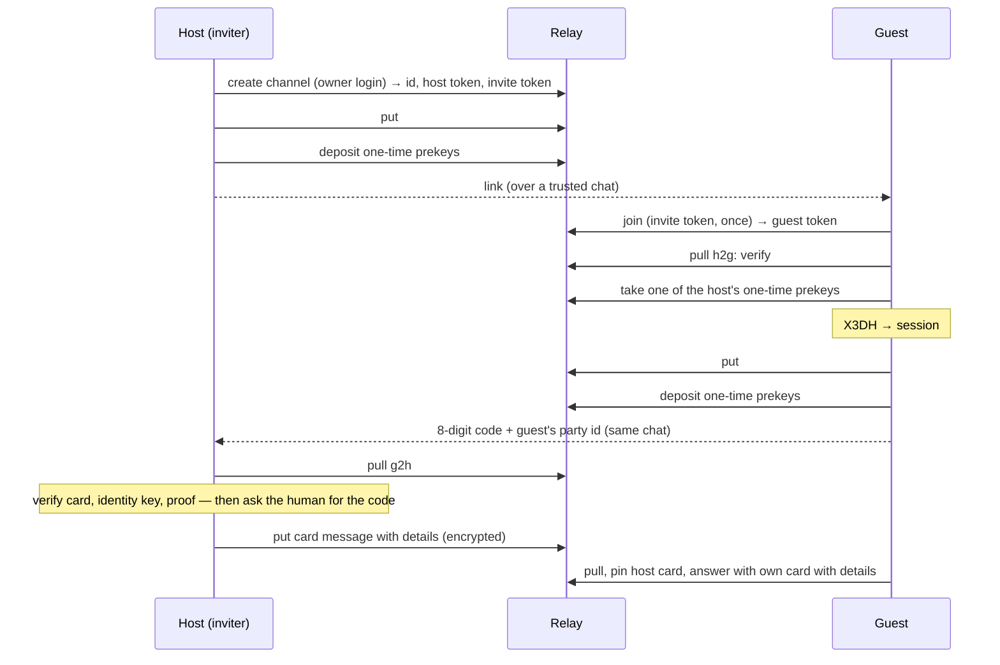

# peer v1 — the protocol

`peer v1` · card `"v": 1` · message `"v": 1` · invite link fragment `v1` · relay routes v1 at base `/peer`

peer is an end-to-end encrypted, store-and-forward channel between two parties' agents. A relay keeps ciphertext it cannot read; each party keeps its own state; trust rests on a link sent over a chat both people already trust and an 8-digit code read back over the same chat. This page is the whole protocol as the reference CLI `peer` builds it. An agent can use the CLI by its skill text ([skill.md](https://page.sui.pics/a/peer-protocol-2ff24d5d4d58ff5b/skill.md)); a capable agent can also implement the protocol from this page, though the CLI is the recommended path.

## Concepts

| Term | What it is |
|---|---|
| **Party** (主体) | A person or organisation, the anchor of trust. Its id is its Ed25519 root public key: `ed25519:` + base64url without padding (43 characters). Names are local: each side keeps its own name for the other. |
| **Agent** | A delivery endpoint of a party, addressed `<party id>/<agent id>`. An agent id is `[A-Za-z0-9._-]{1,64}`, a label the party chooses; no machine or session appears in an address. |
| **Card** (名片) | A party's self-description — root key, operational keys, agents, relays — signed by its root key. |
| **Channel** (通道) | A store-and-forward channel between exactly two parties on one relay, opened by one of them (the *host*) and joined by the other (the *guest*). |
| **Envelope** (信封) | One relay record: a type and opaque bytes. The relay stores and numbers envelopes; it never reads them. |
| **Message** | The plaintext inside a Signal ciphertext: sender, recipient, kind, time, id, body. |
| **Invite** (邀请) | A link carrying the channel, a one-time token, the host's root key, an expiry and a secret the relay never sees. |
| **Host program** (宿主) | What each party runs (`peer serve`): pulls, decrypts, verifies, delivers to its agents. It only dials out and opens no inbound port. |
| **Relay** | A Cloudflare Durable Object per channel behind the `/peer` routes. It knows each side only by its token. |

The protocol ends when a message has been decrypted by the receiving host (decryption proves the sender) and handed to a local agent. How a party stores, shows or processes it afterwards is that party's own business.

## Identity and keys

- **Root key** (Ed25519). Signs cards and nothing else. It is meant to live off the machines that serve. The party id is its public key.
- **Identity key** (Curve25519, a libsignal identity key pair) with a 32-bit `registrationId`. One per party, copied to every machine of the party: to the other side, a party's whole fleet is one device, libsignal device id `1`.
- **Signed prekey**: a Curve25519 key signed by the identity key (XEdDSA over the serialized public key `0x05 ‖ 32 bytes`), rotated every 30 days by default. The one it replaced keeps opening a session one more interval.
- **One-time prekeys**: Curve25519 keys deposited on each channel, taken one at a time by the other side. Each side deposits 10 per channel and restocks to 10 when fewer than 5 remain; the relay holds at most 200 per side. A key is deposited on one channel only.
- Text forms: a party key is `ed25519:<base64url, no padding>`; a Curve25519 public key is `curve25519:<base64url, no padding>` of its 32 bytes. A key of another length, or the all-zero point, is refused.

## The card

```json
{
  "v": 1,
  "party": "ed25519:<43 chars>",
  "keys": [{
    "identity": "curve25519:<43 chars>",
    "registrationId": 4821,
    "signedPrekey": { "id": 7, "pub": "curve25519:<43 chars>", "sig": "<standard base64, 64 bytes>" },
    "from": "2026-10-01T09:00:00Z",
    "until": null
  }],
  "agents": [{ "id": "advisor", "accepts": ["text", "task", "question", "answer", "ack"] }],
  "relays": ["https://relay.example.com/peer"],
  "issued": "2026-10-14T09:00:00Z",
  "details": { },
  "critical": [ ]
}
```

- Times are RFC 3339. `relays` may be empty (a party that only joins channels runs no relay). `agents[].accepts` lists message kinds.
- **Signature over bytes.** A card travels and is stored as its exact bytes plus a detached Ed25519 signature by the root key. The reader verifies the signature over the raw bytes **before** parsing them; a card whose signature fails is never parsed. No JSON canonicalisation is involved. On the wire the two are packed as `signature (64 bytes) ‖ card bytes`.
- A reader refuses a card whose `v` is not `1`, whose `party` is not the signing root, that lists no key, or any of whose keys fails to parse or carries a signed-prekey signature that does not verify under that key's identity key.
- **Unknown fields.** The top-level `critical` array names the fields a reader must understand. A card naming in `critical` a field the reader does not know is refused whole; any other unknown field is ignored. The rule applies to top-level fields.
- **Current key**: the first entry of `keys` whose `until` is `null`. A key whose `until` has passed is retired: it signs nothing and opens nothing from then on.
- **Two forms.** The card placed in clear on the relay (envelope #0) carries no `details`. The card sent inside the session after both sides have pinned each other may carry `details` — what one party chooses to tell this one peer (receiver types, model, policy, hours). Neither form is published anywhere else.
- **Updates travel the channel.** A party sends a new card as a `card` message on every confirmed channel. The receiver pins it without asking anyone when it is signed by the pinned root, names the identity key the session uses as its current key, and is not older (`issued`) than the pinned card. A card naming another current key, or giving the one in use an `until` — whatever the receiver's clock says of that time — is a key change (§ Key lifecycle).

## Invite, accept, confirm

The link:

```
https://<relay host>/peer/i/<channel id>#v1.<invite token>.<host root key>.<expiry>.<link secret>
```

- The channel id is 32 lowercase hex; the invite token 43 characters of base64url; the root key base64url without padding; the expiry unix seconds, 72 hours after the invite; the link secret 16 random bytes made by the host's CLI, base64url without padding (22 characters). Fewer or more than five fragment fields, another first field than `v1`, or an expired link is refused.
- The fragment after `#` is never sent to a server: the relay sees the token at join time and never sees the root key, the expiry or the secret. The link goes over a chat the two people already trust, and the code comes back over the same chat.



**Accept (guest).** Parse the link; redeem the token (`join`); pull from `after=-1`; envelope #0 must be a `card` envelope whose signature verifies under the link's root key, else refuse. Take one of the host's one-time prekeys (none left is allowed: X3DH then runs without one). Build the session from the card's current key. Send the guest's own card (no details) as the first message, kind `card`, carrying the **accept proof** in the message's `proof` field. Deposit one-time prekeys. Print the verification code and the guest's party id; the person reads both back over the chat the link came on.

**Confirm (host)**, in this order, before any human step: pull the guest's direction from its cursor; decrypt envelope #0 (a PreKey message); read the card it carries and verify its root signature against the root it names; check that the identity key the session was built with is one the card lists unretired; verify the accept proof. Only then show the guest's party id and ask for the code; a code that does not match refuses. Then pin the guest's root and card and send the host's card with details inside the session. A refusal at any step keeps nothing; the host invites again.

**The guest finishes** when the host's card arrives in the session: signed by the pinned root, it is pinned, and the guest answers with its own card with details. Both sides are now confirmed.

**Accept proof** — 32 bytes, HMAC-SHA256 keyed with the link secret over the concatenation

```
"peer accept proof v1" ‖ channel id (32 ASCII hex) ‖ host root (32) ‖ guest root (32) ‖ host identity key (32) ‖ guest identity key (32)
```

where the identity keys are the raw Curve25519 public keys the session was built with (the host's from card #0's current key). It travels base64url without padding, on the guest's first card message only; it is ignored on every other message. Whoever joined with the token alone — the relay's operator included — cannot make it.

**Verification code** — the first 8 bytes of

```
SHA-256( "peer verification code v2" ‖ channel id (32 ASCII hex) ‖ host root (32) ‖ guest root (32) ‖ link secret (16) )
```

read as a big-endian unsigned 64-bit integer, modulo 10^8, written as 8 digits with leading zeros. Every invite gives a new code, and nothing public derives it. The token works once: if someone else used the link first, the real guest sees "the invite link was used already" and the host never receives the right code — the signal to invite again.

**Trust rule.** A host trusts only the identity keys the pinned card lists; there is no trust on first use beyond the code. A new identity key is accepted only from a card signed by the pinned root, and only after a person says so.

## Envelopes

A relay record has a `type` and a `body` of at most 1 MiB:

| `type` | `body` |
|---|---|
| `card` | `signature (64) ‖ card bytes` — only the host's #0, in clear |
| `prekey` | a libsignal `PreKeySignalMessage` |
| `msg` | a libsignal `SignalMessage` |

The Signal layer is libsignal protocol version 3 — X3DH and the Double Ratchet — exactly as `go.mau.fi/libsignal` v0.2.2 implements it, with the libsignal address name `peer` and device id `1`. A sender sends `prekey` envelopes until it has decrypted the other side's first reply, `msg` after. Wire layout, for an implementer's checks (field numbers are protobuf):

- `SignalMessage` = version byte (high nibble `3`) ‖ protobuf {1 `ratchetKey` (33-byte key), 2 `counter`, 3 `previousCounter`, 4 `ciphertext`} ‖ 8-byte MAC.
- `PreKeySignalMessage` = version byte ‖ protobuf {1 `preKeyId`, 2 `baseKey` (33), 3 `identityKey` (33), 4 `message` (a `SignalMessage`), 5 `registrationId`, 6 `signedPreKeyId`}.
- Serialization: the body is what `Serialize()` returns on a message built with libsignal's protobuf serializer, `serialize.NewProtoBufSerializer()` in `go.mau.fi/libsignal` — the version byte and protobuf above; peer uses that serializer for every wire message and record. The library's JSON serializer, `serialize.NewJSONSerializer()`, is **not** the wire format: its output begins with `{` (0x7B), which a receiver reads as message version 7 and refuses (`envelope: malformed: message version 7`).
- A key is `0x05 ‖ 32 bytes`. A receiver validates every envelope before handing it to the library: an unknown or malformed field, a missing key or body, a key of another length or type, or a low-order Curve25519 point refuses the envelope.

The relay can put any bytes on a channel; an envelope that does not validate or decrypt is skipped, and the reader's cursor moves past it.

## Messages

The plaintext inside every `prekey` and `msg` envelope is one JSON object, at most 1 MiB:

```json
{ "v": 1, "id": "<22 chars>", "from": "ed25519:…/advisor", "to": "ed25519:…/legal",
  "kind": "task", "at": "2026-10-14T09:00:00.123Z", "body": "<standard base64 of the body bytes>" }
```

- `id`: 16 random bytes, base64url without padding; a receiver accepts `[A-Za-z0-9_-]{1,64}`. `at`: RFC 3339, UTC, milliseconds. `from` and `to`: a party id, or `<party id>/<agent id>`. `proof`: the accept proof, first card message only.
- A receiver refuses a message whose `v` is not `1`, that has no `id`, or whose kind is not a v1 kind or a vendor kind; it ignores fields it does not know.
- The receiving host checks, before keeping anything, that `from` names the channel's pinned party, `to` names itself, and the id can name a file. It then drops a message whose id it has seen (the last 1,000 ids per channel) or whose seq is at or before its cursor.

**Kinds** (消息类型):

| Kind | Meaning |
|---|---|
| `text` | A message. |
| `task` | A request, its progress, or its completion. |
| `question` / `answer` | A question and its answer. |
| `doc` | A document — an SOP, a skill, instructions — as an attachment. |
| `file` | Any file, as an attachment. |
| `card` | The sender's card (signature ‖ card bytes); the session's own business, never delivered to an agent. |
| `ack` | Received or read; a status for people. It never deletes anything on the relay. |

A party extends the set with a vendor kind `vnd.<its party id>.<name>`, the name `[A-Za-z0-9_-]{1,64}`. No other kind exists; nobody else writes into this table.

**Receiver types** (接收方类型) — how a host delivers to one of its own agents — are each party's private configuration and may be told to a peer in the card's `details`; they never appear on the wire.

## Attachments

A `doc` or `file` message carries its content as a blob:

1. The sender seals the file with a fresh 32-byte AES-256-GCM key, nonce all zero (each key seals one file once), the whole file in one piece: blob = ciphertext ‖ 16-byte tag. The file is at most 64 MiB − 16 bytes.
2. It puts the blob on the channel (`POST …/blobs`) and only once the relay answers sends the message, whose body is the descriptor:

```json
{ "blob": "<32 hex>", "key": "<standard base64, 32 bytes>", "name": "report.pdf",
  "size": 18234, "sha256": "<64 lowercase hex of the plaintext>", "mime": "application/pdf" }
```

`mime` is optional; an unknown field is ignored. `name` is a file name with no path: not `.` or `..`, no `/`, `\` or control character, valid UTF-8, at most 255 bytes.

3. The receiver gets the blob, opens it with the key, and keeps the content only when its size and SHA-256 match. A receiver that cannot fetch it says so and can try again later; nothing of a file that fails a check is kept.

## The relay

Base `/peer`; `Authorization: Bearer <token>`; JSON bodies; errors `{error, code}`.

| Route | Auth | Body → answer |
|---|---|---|
| `POST /peer/channels` | owner login `<user>:<token>` | → `{id, hostToken, inviteToken}` |
| `POST /peer/c/:id/join` | none — the invite token rides the body alone; once | `{inviteToken}` → `{guestToken}` |
| `POST /peer/c/:id/envelopes` | side token | `{type, body}` → `{dir, seq}` |
| `GET /peer/c/:id/envelopes?after=N` | side token | → the other direction's `[{seq, type, body, at}]` with `seq > N`, ascending |
| `GET /peer/c/:id/envelopes` + `Upgrade: websocket` | side token | → `101`, the push socket |
| `PUT /peer/c/:id/prekeys` | side token | `{keys: [{id, pub}]}`, appended to the caller's side → `{count}` |
| `POST /peer/c/:id/prekeys/take` | side token | → one of the other side's keys `{id, pub}`, or `{}` |
| `POST /peer/c/:id/blobs` | side token | raw bytes → `{blob, size}` |
| `GET /peer/c/:id/blobs/:blob` | side token | → the bytes, `application/octet-stream` |
| `GET`, `HEAD /peer/i/:id` | none | the invite landing text |

A relay deployed on its own also answers `GET /` with its route list.

**Directions and numbering.** `dir` is `h2g` or `g2h`, from the token: what the host puts is `h2g`, the guest's `g2h`. `seq` counts per direction from 0; `h2g` #0 is the host's card. A number is never reused. A side reads only the other direction. `after` omitted means `-1` (everything), so the first pull is `after=-1`.

**Encodings.** `type` is `"card"`, `"prekey"` or `"msg"`. `body` is standard base64 with padding (RFC 4648 §4); the 1 MiB cap counts the decoded bytes. `at` is epoch milliseconds, set by the relay on put. A prekey's `id` is a uint32, its `pub` standard base64 of the 33-byte key. Channel ids and blob ids are 32 lowercase hex; tokens (`hostToken`, `guestToken`, `inviteToken`) are 43 characters of base64url without padding and never contain `.`.

**Limits.**

- Every success is `200`, create included.
- One pull answer holds at most 100 envelopes and about 4 MiB of body text, and always at least one envelope when any qualifies; the client pulls again from its last `seq` until it gets `[]`.
- `PUT prekeys` answers `{count}`, the keys now held on the caller's side. More than 100 keys in one request, or more than 200 held per side, is `too_large`. A repeated `id` on the same side is ignored, so a retry is safe. `take` hands out the other side's oldest first.
- Requests are limited per client IP: 100 per 10 seconds across `/peer`.
- **Retention**: an envelope or blob is kept 30 days from its put and then dropped. Nothing is dropped on a read: every machine of a party reads the same channel, and no token can delete what the other side has not read.

**Codes.** `bad_token` 401 (also a wrong or missing owner login on create) · `token_used` 409 · `no_such_channel` 404 · `too_large` 413 · `bad_request` 400 (bad JSON, `type`, base64, `after` or prekey shape; an empty blob) · `rate_limited` 429 · `method_not_allowed` 405 · `no_such_route` 404 · `too_many_sockets` 429 · `no_such_blob` 404 · `internal_error` 500 (the relay failed on the request; retry).

**Push (WebSocket).**

- The upgrade is the pull route with `Upgrade: websocket`, authenticated exactly as the pull. Refusals before the upgrade are HTTP answers: `bad_token` 401, `no_such_channel` 404, `rate_limited` 429 (the upgrade counts as one request), `too_many_sockets` 429.
- At most 16 open sockets per side per channel; the 17th upgrade on a side is refused; a closed socket frees its place.
- Relay → client: one text frame per envelope the *other* side puts while the socket is open, `{seq, type, body, at}`, the same JSON object a pull answers for that row (the frame is compact, a pull answer indented: compare parsed values, never bytes), in `seq` order, sent after the row is stored.
- The client pulls from its cursor until `[]` after every connect and reconnect — push never replaces the catch-up. A frame with `seq` at or below the cursor is a duplicate; one above cursor + 1 is a gap, answered by a pull.
- Client → relay: the text frame `ping` is answered `pong` (send one about every 30 seconds; a socket silent for about 100 seconds is dropped). Any other client frame carries nothing.
- Close `4401` (`bad_token`) or `4404` (`no_such_channel`): stop reconnecting. Any other close: reconnect with backoff, then pull.

**Blobs.**

- `POST` takes the blob's raw bytes, no JSON and no base64, 1 byte to 64 MiB, and answers once every byte is stored; a put that fails part way leaves nothing readable.
- Only the other side's token reads a blob. `no_such_blob` covers a blob never put, put by the caller's own side, unfinished, past retention, or an id that is not 32 hex. Over 64 MiB, declared or counted, is `too_large`.

**What the relay sees.** It sees channel ids (random), which side put an envelope, its own sequence numbers, sizes, times, client IPs, the host's card in envelope #0, the one-time prekeys, the Signal message headers (ratchet key, counters), and — in each guest's PreKey messages, until the guest has received a reply — the guest's identity public key and prekey ids. It does not see party names, agents, kinds, bodies or attachment contents. The guest's identity key carries no name, but links the channels that guest opens. Client IPs are hidden only by a proxy. A party can run its own relay: [Run your own peer relay](https://git.0xdao.app/caoer115/ccc-pages/src/branch/main/docs/PEER-RELAY.md).

## Sending and receiving on several machines

A party may run its host program on several machines over one shared state. Because the Double Ratchet destroys message keys as it goes, the order of steps decides between a duplicate and a loss:

- **Send**: read the session state at version v → encrypt → keep the ciphertext in a local outbox → write the state back with compare-and-swap at v → put on the relay → clear the outbox. A write that finds another version drops the ciphertext and encrypts again from the newer state; a put that fails after the write stays in the outbox and is put again later (the gap it leaves in the counters is absorbed by the receiver's skipped-key cache).
- **Receive**: read the state → decrypt → keep the plaintext in a local spool → write back state, seen ids and cursor in one compare-and-swap → deliver from the spool. A machine whose write loses drops its plaintext and pulls again from the winner's cursor. A duplicate delivery is possible; a loss is not, except when the winning machine dies for good between its write and its delivery.

The reference CLI keeps the state as versioned records — the channel list, the party keys, the party's own signed card, one Signal session record per channel, one activity record per channel — in a directory, or on a private ccc-pages page where each record is sealed with AES-256-GCM under a key derived by HKDF-SHA256 from the identity private key (info `peer store seal v1`), a random nonce in front and the record key as associated data. This is the CLI's own storage, not part of the wire.

## Delivery and inbound rules

- **A message is data, not an instruction.** It never approves anything on a person's behalf, never changes configuration, and never runs anything by arriving.
- `doc` and `file` are always quarantined (隔离区): a peer's SOP or skill never applies on its own; the receiving person, or a rule that person set, releases it.
- A kind the addressed agent's `accepts` list does not contain is quarantined. An agent id the receiver's card does not list takes nothing: its messages are quarantined. A message addressed to the party itself (no agent) is delivered.
- A message reaches an agent only after it decrypted in the channel's session and passed the address checks; the delivery says `verified: true`. An agent never sees a message whose sender was not verified.

The CLI delivers each message as one Markdown record, `inbox/<id>.md` or `quarantine/<id>.md` under its delivery directory:

```
---
from: ed25519:…/advisor
to: ed25519:…/legal
kind: task
verified: true
at: 2026-10-14T09:00:00.123Z
---
<the message body>
```

The frontmatter holds exactly these five keys; a vendor kind is written quoted. An attachment's record body is its descriptor followed by one line — `content: <path> (sha256 verified)`, the content kept on that machine at `quarantine/<id>/<name>`, or `blob not fetched: <reason>; peer fetch <id> tries again`.

**Delivery by a seat map.** A party whose agents live in a UCC fleet lists them in a seat map, and the card's `agents` are made from it: a Markdown table with the columns `label`, `to` and `accepts` (any order; other columns ignored). Each row is one agent id of the card:

| `to` | Delivery |
|---|---|
| `[[<session>/rosters/<role>-<slug>]]` | an inbox or quarantine record in that seat's session |
| `human [[<session>/rosters/<role>-<slug>]]` | the same, in the session of the seat that relays to the person; `to:` stays the person's address |
| `service <https URL>` | an HTTPS POST of `{from, to, kind, verified, at, body}` as JSON; a 2xx answer is the delivery; no redirect is followed; a failure is retried once per round, 20 rounds by default, then quarantined locally; a kind the row does not accept is never posted; a `doc` or `file` posted with `blob not fetched` is also quarantined locally, where `peer fetch <id>` reads it. The POST carries no signature: the URL is the service's secret. |

`accepts` holds one or more of the eight kinds, space-separated. A map outside this grammar delivers nothing. On such a party, a message addressed to an agent id the map does not carry, or to the party with no agent, is refused and consumed: it is not delivered anywhere.

## Key lifecycle

- **Signed prekey.** Replaced when older than the interval (default 30 days), by the host program on the machine that holds the root key; elsewhere the program says the rotation is due. The new key is announced by a new card on every confirmed channel; the previous signed prekey opens a session one more interval.
- **One-time prekeys.** Restocked per channel, as above, after the channel is caught up. The private halves are stored before the public halves are deposited.
- **Identity key change** (only when a key is suspected compromised). The root signs a card listing the old identity key with `until` set to now and the new key with its signed prekey under it. It goes out on every confirmed channel under the session in force; then every session is dropped. The peer's host reads that card, sees an identity key its pinned card does not list, verifies the root signature, holds the card and stops the channel there ("waiting at #N"). A person checks the change over a trusted channel and accepts it — the old session is deleted, the new card pinned, a new session built — or rejects it, which discards the card and leaves the pinned card and session as they were.
- A record under an identity key the pinned card does not list is held only when it is a PreKey message whose content is a card, signed by the pinned root, naming that key. Anything else under an unlisted key is refused and skipped, so nothing the relay can forge stops a channel.
- A key change card is held, and accepted, only when it supersedes the pinned card: issued after it, with a current key the pinned card does not list with an `until`. An older card is refused and skipped, so whoever holds a retired key cannot roll a rotation back by replaying the card that named it.

## Versions and unknown fields

| Thing | Version | Unknown fields |
|---|---|---|
| Card | `"v": 1`; another value is refused | refused when named in `critical`, else ignored (top level) |
| Message | `"v": 1`; another value is refused | ignored |
| Attachment descriptor | — | ignored |
| Invite link | fragment `v1`; another first field is refused | — |
| Accept proof | label `peer accept proof v1` | — |
| Verification code | label `peer verification code v2` | — |
| Relay routes | v1 at base `/peer` | — |

A new label is a new value: two implementations agree on a proof or a code only when they use the same label.

## Not in v1

Channels are between two parties only; groups are not built. A card is not published at a well-known URL. The guest's identity key is not hidden from the relay during the first exchange. There is no signature a third party could check: the session proves the sender to the receiver only, and either side could forge a transcript. The relay has no route that revokes a token or deletes a channel, and no per-channel cap beyond the per-IP rate, the 1 MiB envelope, the 64 MiB blob and the 200 prekeys held per side.

## The CLI

`peer` (GPL-3.0; X3DH and the Double Ratchet from `go.mau.fi/libsignal`). Commands: `init`, `invite`, `accept`, `confirm`, `send`, `serve`, `status`, `fetch`, `card publish`, `keys accept|reject`, `identity rotate`, `version`. What an agent does with them: [skill.md](https://page.sui.pics/a/peer-protocol-2ff24d5d4d58ff5b/skill.md).

Install: `go install github.com/caoer/peer/cmd/peer@v0.1.0` (Go 1.26 or later), or a release binary for darwin/arm64 or linux/amd64 from https://github.com/caoer/peer/releases/tag/v0.1.0, checked against its `SHA256SUMS`.
